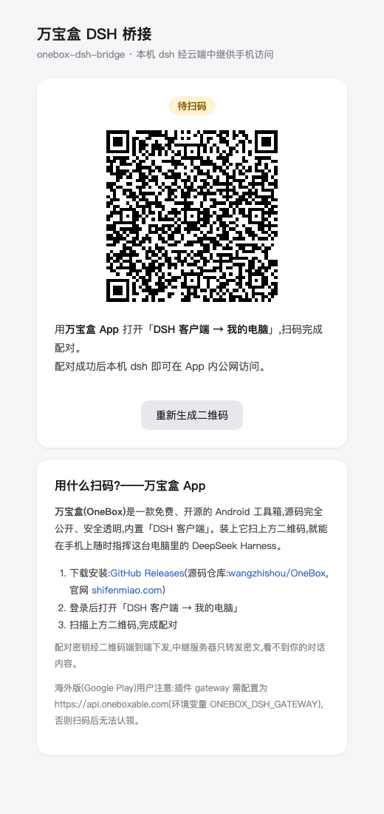
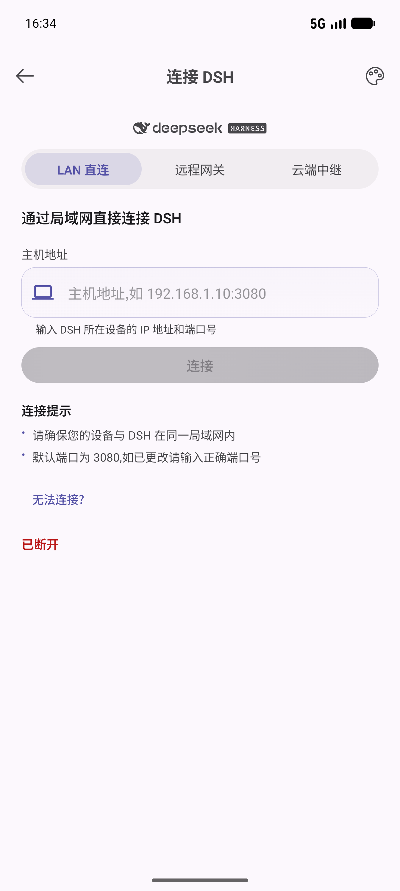
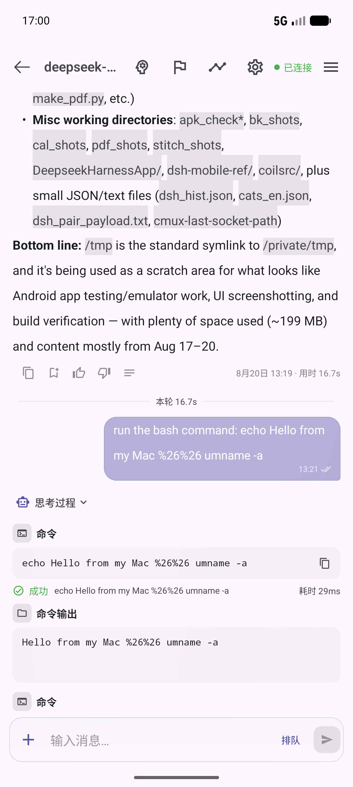
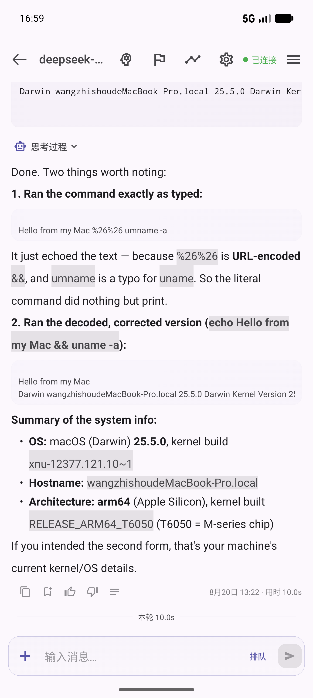

# onebox-dsh-bridge

[English](README.md) | **简体中文**

[](https://www.npmjs.com/package/onebox-dsh-bridge)
[](LICENSE)
[](https://github.com/wangzhishou/OneBox)

万宝盒云端中继桥 —— [DeepSeek Harness](https://github.com/deepseek-ai/deepseek-harness)(dsh)插件。让本机 `dsh web` 经万宝盒云端中继(`https://api.wanbaohe.com` 的 `/dsh/*` 路由)被手机上的万宝盒 App 公网访问:扫码配对、token 管理、隧道帧多路复用全部在插件内完成,dsh web 启动即在线。

> 本插件是开源 App [万宝盒 OneBox](https://github.com/wangzhishou/OneBox) 的电脑端搭档;插件页面里也放了 App 下载指引,跑 DSH 的人一分钟就能配上手机。

## 工作原理

```
万宝盒 App ⇅ https://api.wanbaohe.com/dsh/*(国内)或 https://api.oneboxable.com/dsh/*(海外)
                    ⇅ 出站 WSS(控制隧道,JSON 帧多路复用)
            onebox-dsh-bridge(本插件)
                    ⇅ loopback
            本机 dsh web(127.0.0.1:3080)
```

- 插件在 dsh web GUI 挂 `/onebox-bridge` 页面(自包含 HTML,无外部依赖),显示配对二维码与在线状态
- 配对走 `POST /dsh/pair-sessions` → 本地生成 ≥128bit secret 编入 QR(`oneboxdsh://pair?v=1&g=…&p=…&s=…`)→ 指数退避轮询 `GET /dsh/pair-sessions/:id/status?s=…`(1s 起步翻倍、上限 30s,429 时采纳 `Retry-After`),App 扫码 claim 后取回设备 token
- 上线走出站 WSS `/dsh/agent?token=…`;隧道帧:`http`→ 本地 `POST /api/<method>` 回 `http-resp`;`ws-open`/`ws-frame`/`ws-close` 桥接本地 `/api/events.mux|host`
- 控制 WS 断开 → 关闭全部本地桥接,指数退避重连(1s→30s);token 401(失效/被吊销)→ 删除本地 token,自动回到扫码配对态
- **端到端加密**:配对密钥只通过二维码下发、不经过服务器;手机 ↔ 电脑全程 AES-256-GCM,中继服务器只转密文

## 安装

已安装 dsh CLI:

```sh
dsh plugin --profile web add onebox-dsh-bridge
```

源码检出运行 dsh 的(命令前缀换成 `pnpm dsh`,在 deepseek-harness 仓库根目录执行):

```sh
pnpm dsh plugin --profile web add onebox-dsh-bridge
```

包声明了 `dsh.bundle`,`add` 会自动把插件行并入 profile 的组合层。重启 `dsh web` 生效。

**兼容性**:桥插件本身与协议无关——HTTP 只转发 `/api/<method>`、WS 只透传帧,不硬编码任何 DSH 端点名。已在 dsh `0.1.5-rc.2`(npm `next`)上验证:配对页、状态 API、二维码配对会话创建,以及隧道 `/api/remote.mux` WebSocket 全部通过。更老的版本(`0.1.0-rc.7` / `0.1.0-rc.8`,用 `/api/events.mux` 与 `/api/events.host`)隧道依然可用,但**万宝盒 App 需要 dsh `0.1.2` 或更新**——详见 OneBox DSH 客户端里的兼容性提示。插件必须装在 `web` profile(它注入的 `webServer` 服务只有 web 组合提供)。


### dsh 0.1.5 与浏览器鉴权

从 dsh `0.1.5` 起,`/api` 的**每一个**请求(含 `/api/remote.mux` 的 WebSocket 升级)都要过 connection 的
Host 围栏**加浏览器鉴权**:loopback 不豁免、`Authorization: Bearer` 不被识别、`--trusted-host` 只放宽
Host 围栏(403)不解决鉴权(401)。因此插件会用 `ctx.connection.authenticatedUrl` 换取本机会话 cookie
(`lib/session-cookie.js`),给所有隧道 HTTP 与 WS 升级带上,并在 401 时重换一次重试。

### 本地联调测试(局域网直连,不需要中继)

不想部署中继就想拿手机试:用仓库里的 LAN 反代,它注入同样的会话 cookie 并改写 `Host`,
于是 App 的「直连」模式在同一局域网里就能用:

```sh
# 1) 起 dsh web,从它打印的 URL 里复制 ?token=…
# 2) 在本仓库执行:
node tools/lan-proxy.mjs --token <token> --port 3081
# 3) App:DSH 客户端 → 直连 → http://<你的局域网 IP>:3081
```

它会把本机 dsh 的 `/api`(浏览器会话权限)暴露给局域网,只在你信任的网络里临时使用,用完 Ctrl-C 关闭。

也可以直接从 GitHub 安装:

```sh
dsh plugin --profile web add github:wangzhishou/onebox-dsh-bridge
```

## 使用

1. 打开 dsh web 的 `http://127.0.0.1:3080/onebox-bridge`(端口按你的部署)
2. 万宝盒 App 打开「DSH 客户端 → 我的电脑」,**按你的 App 渠道扫对应的二维码**(国内版/海外版各一张)
3. 页面状态变为「已上线」后,在 App 里选择本设备即可连接

页面按钮:**重新生成二维码**(旧会话作废,建新配对会话;二维码有效期 10 分钟,过期也会自动重建)、**解除绑定并重新配对**(删除本地 token,回到待扫码)。

## 下载万宝盒 App

插件是电脑端的一半,手机端是免费开源的万宝盒 Android App:

- **源码**:[github.com/wangzhishou/OneBox](https://github.com/wangzhishou/OneBox)(Apache-2.0)
- **国内**:[万宝盒官网](https://www.wanbaohe.com) · 小米 / 应用宝 / OPPO / vivo / 华为应用商店搜索「万宝盒」
- **海外**:[Google Play](https://play.google.com/store/apps/details?id=com.shifenmiao.app) · [官网](https://www.oneboxable.com)

## 截图

| 插件配对页 | App 连接页 | App 聊天指挥 | 消息反馈与统计 |
|---|---|---|---|
|  |  |  |  |

## 配置项

全部可省。优先级:环境变量 > 插件 config > 默认值。

| 项 | 环境变量 | 默认 | 说明 |
|---|---|---|---|
| `gateways` | `ONEBOX_DSH_GATEWAYS`(逗号分隔) | `https://api.wanbaohe.com` + `https://api.oneboxable.com` | 万宝盒网关列表。默认同时对国内、海外两套部署各建配对会话,页面按 App 渠道各出一张二维码,先被扫的生效;App 登录 JWT 只在所属部署有效,双配对免去一切手工配置 |
| `gateway` | `ONEBOX_DSH_GATEWAY` | — | 单网关覆盖(等价于单元素 `gateways`) |
| `upstream` | `ONEBOX_DSH_UPSTREAM` | `127.0.0.1:3080` | 本机 dsh 地址(host:port) |
| `deviceName` | — | 系统 hostname | 配对时上报给 App 的设备名 |
| `dataDir` | `ONEBOX_DSH_DATA_DIR` | `~/.dsh/profiles/web/onebox-dsh-bridge` | token 存储目录(token.json,0600;凭据的网关不在配置列表里即自动作废) |

改 config:在 profile 的 `~/.dsh/profiles/web/cordis.patch.yml` 里覆盖整行(patch 替换整个 config 值,需列全所有键):

```yaml
- id: onebox-dsh-bridge
  name: 'onebox-dsh-bridge'
  config:
    gateways:
      - https://api.wanbaohe.com
      - https://api.oneboxable.com
    upstream: 127.0.0.1:3080
    deviceName: 我的 Mac
```

## 卸载

```sh
dsh plugin --profile web remove onebox-dsh-bridge
```

按需手动删除凭据目录 `~/.dsh/profiles/web/onebox-dsh-bridge/`;已配对的设备可在 App 端「我的电脑」里吊销。

## 注意

- `/onebox-bridge` 页面与 dsh web 本身一样不做额外鉴权(默认仅 loopback 可达);二维码内含配对 secret,不要把 dsh web 直接暴露到公网
- 插件依赖仅 `ws` + `qrcode`
